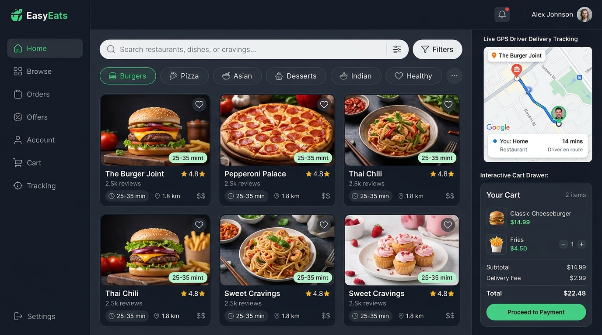
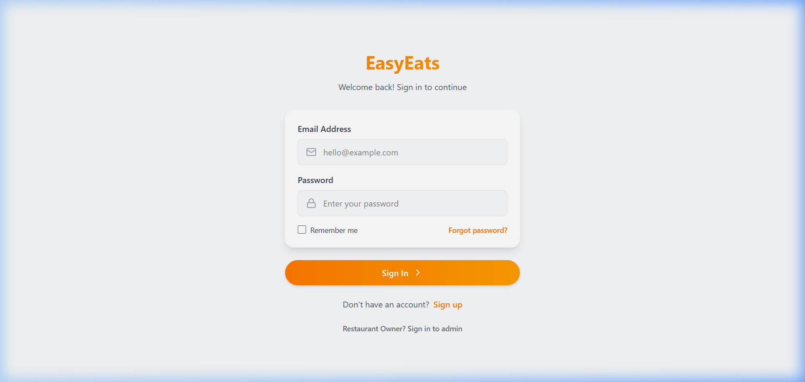
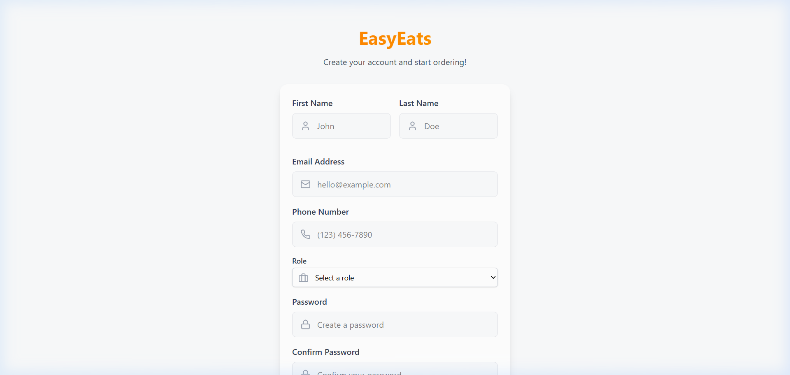
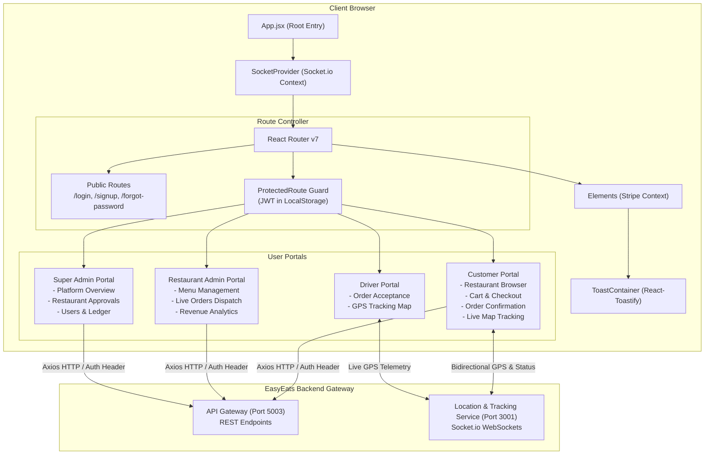
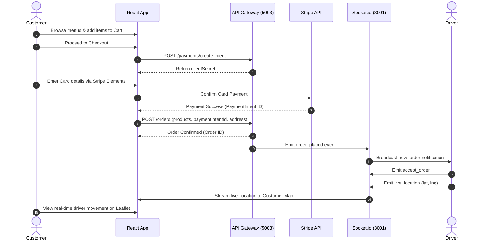

# 🍔 EasyEats Frontend — Next-Gen Food Delivery Web Platform

<p align="center">
  
</p>

<p align="center">
  <a href="https://react.dev/"></a>
  <a href="https://vitejs.dev/"></a>
  <a href="https://tailwindcss.com/"></a>
  <a href="https://socket.io/"></a>
  <a href="https://stripe.com/"></a>
  <a href="https://leafletjs.com/"></a>
</p>

---

## 📖 Overview

**EasyEats Frontend** is a modern, high-performance, responsive Single-Page Application (SPA) built with **React 18**, **Vite 6**, and **Tailwind CSS 4**. It delivers an intuitive, full-featured food ordering and logistics experience tailored for four distinct user personas:

1. **Customers**: Discover local restaurants, customize orders, securely pay with Stripe, and track delivery drivers on an interactive live map.
2. **Restaurant Owners (Admins)**: Manage dynamic menus, dish categories, real-time incoming order tickets, store configurations, and revenue earnings.
3. **Delivery Drivers**: Accept incoming delivery dispatches, broadcast live GPS telemetry, and update order statuses on the road.
4. **Super Admins**: Oversee platform-wide analytics, monitor restaurant onboarding and verification, inspect users, and audit platform transactions.

---

## 🎬 Screen Recording & Platform Walkthrough

Experience EasyEats in motion — from login and multi-role authentication to real-time cart handling and dashboard control:

### 📹 Live Screen Recording Demonstration

<p align="center">
  
</p>
<p align="center"><em>Real-time screen recording demonstrating user navigation, authentication flows, and interactive state transitions.</em></p>

---

## 📸 Screenshots & Interface Previews

<div align="center">
  <table>
    <tr>
      <td width="50%" align="center">
        <strong>Customer Experience & Food Catalog</strong><br/><br/>
        
      </td>
      <td width="50%" align="center">
        <strong>Restaurant & Dispatch Control Center</strong><br/><br/>
        
      </td>
    </tr>
    <tr>
      <td width="50%" align="center">
        <strong>Secure Authentication Portal</strong><br/><br/>
        
      </td>
      <td width="50%" align="center">
        <strong>Role-Based Registration</strong><br/><br/>
        
      </td>
    </tr>
  </table>
</div>

---

## 🌟 Key Features

### 🛍️ Customer Experience
- **Restaurant Discovery**: Search restaurants with geospatial proximity, cuisine filters, ratings, and preparation time indicators.
- **Interactive Food Menus**: Browse categorized menus, dietary tags, ingredient descriptions, and customizable quantity options.
- **Real-Time Cart & Checkout**: Client-persisted shopping cart with subtotal calculation, delivery fee computation, and promo codes.
- **Stripe Elements Payment**: Full PCI-compliant card payments using `@stripe/react-stripe-js` and Stripe Payment Intents.
- **Live GPS Tracking**: Real-time Leaflet map displaying driver location updates, routing paths, and estimated arrival times (ETA).
- **Notifications & History**: Live order updates, past order history inspection, and refund submission workflows.

### 🏪 Restaurant Admin Portal (`/admin/*`)
- **Interactive Analytics Dashboard**: Visual revenue summaries and order volume statistics powered by **Recharts**.
- **Menu Management (CRUD)**: Create, edit, toggle availability, and set pricing for dishes and categories with Cloudinary image previews.
- **Live Order Board**: Track incoming orders with instant status transitions: `Pending` ➔ `Processing` ➔ `Shipped` ➔ `Delivered`.
- **Earnings & Payouts**: Daily, weekly, and monthly revenue breakdowns.
- **Store Configuration**: Manage store operating hours, contact details, and restaurant profile metadata.

### 🛵 Delivery Driver View (`/driver/map`)
- **Live Dispatch Radar**: Receive `new_order` notifications via WebSocket.
- **Real-Time Coordinates Broadcast**: High-frequency driver GPS coordinates pushed to server via Socket.io.
- **Delivery Milestone Controls**: Update delivery states (`Picked Up`, `Arrived`, `Delivered`).

### 👑 Super Admin Platform Portal (`/superadmin/*`)
- **Platform-Wide Command Center**: Global active user count, gross merchandise value (GMV), and system order status overview.
- **Restaurant Verification**: Approve new restaurant applications, set commission rates, or suspend non-compliant vendors.
- **User Management**: Search, filter, and audit customer, driver, and vendor accounts.
- **Payment Gateway Ledger**: Audit Stripe charges, refunds, and payouts.

---

## 📐 Application Architecture & Data Flow

### Component & System Hierarchy



### End-to-End Customer Order Flow



---

## 📂 Project Directory Structure

```text
EasyEats-frontend/
├── docs/
│   └── assets/                        # Screenshots, diagrams, and screen recordings
│       ├── demo_walkthrough.webp      # Full platform screen recording
│       ├── ui_showcase.png            # Customer food delivery UI preview
│       ├── admin_dashboard_showcase.png # Restaurant admin dashboard preview
│       ├── architecture_diagram.png   # Full system architectural blueprint
│       ├── screenshot_login.png       # Captured login interface
│       ├── screenshot_signup.png      # Captured signup interface
│       └── screenshot_cart.png        # Captured shopping cart interface
├── public/                            # Static public web assets
├── src/
│   ├── assets/                        # Local component imagery and icons
│   ├── components/                    # Reusable modular UI components
│   │   ├── banuka/                    # Geolocation & Leaflet map components
│   │   │   ├── hooks/                 # Custom driver tracking socket hooks
│   │   │   ├── Maps.jsx               # Interactive Leaflet live map widget
│   │   │   └── SocketContext.jsx      # Global Socket.io provider
│   │   ├── FoodCard.jsx               # Dish display card with add-to-cart
│   │   ├── FoodieCard.jsx             # Restaurant card with rating & distance
│   │   ├── Navbar.jsx                 # Dynamic responsive top navigation
│   │   ├── Footer.jsx                 # Site footer & branding
│   │   ├── ProtectedRoute.jsx         # Client-side JWT auth guard
│   │   └── UserLayout.jsx             # Common dashboard shell layout
│   ├── lib/                           # Utility libraries and API callers
│   │   ├── api/                       # Modular Axios API wrappers (users, orders)
│   │   ├── auth.js                    # JWT extraction & storage helpers
│   │   └── utils.js                   # Class merging & formatters
│   ├── pages/                         # Route page views
│   │   ├── Admin/                     # Restaurant Admin portal
│   │   │   ├── AdminDashboard.jsx     # Recharts revenue & order metrics
│   │   │   ├── AdminMenu.jsx          # Menu items CRUD & category builder
│   │   │   ├── AdminOrders.jsx        # Live order progression Kanban board
│   │   │   ├── AdminEarnings.jsx      # Revenue analytics & payout history
│   │   │   ├── AdminSettings.jsx      # Restaurant operational settings
│   │   │   └── AdminProfile.jsx       # Admin user account profile
│   │   ├── SuperAdmin/                # Super Admin platform oversight
│   │   │   ├── SuperAdminDashboard.jsx# System-wide metrics & telemetry
│   │   │   ├── SuperAdminRestaurants.jsx # Restaurant verification & approval
│   │   │   ├── SuperAdminUsers.jsx    # User audit and permission controls
│   │   │   ├── SuperAdminOrders.jsx   # Global order transaction log
│   │   │   └── SuperAdminPayments.jsx # Global Stripe payments audit ledger
│   │   ├── banuka/                    # Delivery tracking pages
│   │   │   └── DeliveryTrackingPage.jsx # Dual-mode driver/customer tracking
│   │   ├── Cart.jsx                   # Shopping cart review & checkout trigger
│   │   ├── CreateResturant.jsx        # Multi-step restaurant onboarding wizard
│   │   ├── ForgetPassword.jsx         # Password recovery workflow
│   │   ├── Home.jsx                   # Customer landing view & food recommendations
│   │   ├── Login.jsx                  # Multi-role authentication page
│   │   ├── Notification.jsx           # Real-time alert notifications inbox
│   │   ├── Order.jsx                  # Checkout summary & address selection
│   │   ├── OrderConfirmed.jsx         # Post-order celebration & receipt
│   │   ├── Payment.jsx                # Payment gateway selector
│   │   ├── Profile.jsx                # User account & address book editor
│   │   ├── Refund.jsx                 # Refund submission & dispute tracker
│   │   ├── Restaurant.jsx             # Restaurant directory with category filters
│   │   ├── ResturantDetails.jsx       # Full restaurant menu & dish customization
│   │   ├── SearchDishes.jsx           # Global dish keyword and tag search
│   │   ├── SignUp.jsx                 # Multi-role registration screen
│   │   ├── Stripepayment.jsx          # Stripe Elements card checkout flow
│   │   └── StripePaymentInterface.jsx # Payment confirmation & verification
│   ├── App.jsx                        # Routing hub, Stripe & Socket config
│   ├── index.css                      # Tailwind CSS root styles
│   └── main.jsx                       # React DOM mount point
├── .env.example                       # Sample environment configuration
├── eslint.config.js                   # ESLint configuration
├── index.html                         # HTML5 template entry
├── package.json                       # Dependencies & scripts
└── vite.config.js                     # Vite build configuration
```

---

## 🛠️ Tech Stack & Key Libraries

| Technology | Version | Purpose |
| :--- | :--- | :--- |
| **React** | `^18.2.0` | Declarative component-based UI framework |
| **Vite** | `^6.3.1` | Ultra-fast build tool and development server with HMR |
| **Tailwind CSS** | `^4.1.4` | Modern utility-first CSS styling |
| **React Router DOM** | `^7.5.1` | Declarative routing and route guarding |
| **Socket.io Client** | `^4.8.1` | Real-time WebSocket connection for live GPS and alerts |
| **Leaflet & React-Leaflet** | `^1.9.4 / ^4.2.1` | Mobile-friendly interactive map for delivery tracking |
| **Stripe React SDK** | `^2.4.0` | PCI-compliant payment inputs and card authorization |
| **Recharts** | `^2.15.3` | Composable charting library for admin revenue analytics |
| **Lucide React** | `^0.503.0` | Clean, modern iconography |
| **Axios** | `^1.9.0` | Promise-based HTTP client for API Gateway integration |
| **React Toastify & SweetAlert2** | `^11.0.5 / ^11.20.0` | Polished user feedback toasts and modal dialogs |
| **JWT Decode** | `^4.0.0` | Client-side parsing of user roles from JWT tokens |

---

## 🚀 Getting Started & Local Setup

### Prerequisites
- **Node.js**: `v18.0.0` or higher (recommended: `v20.x`)
- **npm**: `v9.0.0` or higher
- **EasyEats Backend**: Running locally on `http://localhost:5003` (or via Docker Compose)

### 1. Clone the Repository
```bash
git clone https://github.com/EasyEats-DS/EasyEats-frontend.git
cd EasyEats-frontend
```

### 2. Install Dependencies
```bash
npm install
```

### 3. Configure Environment Variables
Create a `.env` file in the root directory (based on `.env.example`):
```bash
cp .env.example .env
```

Set the following variables:
```env
# URL of the EasyEats API Gateway
VITE_BASE_URL=http://localhost:5003

# Stripe Publishable Key (from Stripe Dashboard -> Developers -> API Keys)
VITE_STRIPE_PUBLISHABLE_KEY=pk_test_51RGkbGP1kuLOW6vWZKk31RXfliqSdJvsCn7WU9kXYsCPwulxzli7FN1OnltQGeMIODZAPy9RTd3qwaMlMkTXAvp200Wf8d90Fr
```

### 4. Run Development Server
```bash
npm run dev
```
Open your browser and navigate to **`http://localhost:5173`**.

### 5. Production Build & Preview
To create an optimized production build:
```bash
# Build the production bundle
npm run build

# Preview the built application locally
npm run preview
```

---

## ⚡ WebSocket Events Reference (`location_org`)

The frontend communicates with the real-time tracking service (`http://localhost:3001`) via Socket.io:

| Event Name | Direction | Payload Example | Description |
| :--- | :--- | :--- | :--- |
| `identify` | Client ➔ Server | `{ userId: "123", role: "driver" }` | Registers user session on the socket server |
| `accept_order` | Driver ➔ Server | `{ orderId: "ord_99", driverId: "123" }` | Driver claims an incoming order |
| `live_location` | Driver ➔ Server | `{ driverId: "123", latitude: 6.927, longitude: 79.861 }` | Periodic GPS telemetry update |
| `live_location` | Server ➔ Customer | `{ driverId: "123", latitude: 6.927, longitude: 79.861 }` | Real-time pin movement on Customer Map |
| `status_update` | Driver ➔ Server | `{ orderId: "ord_99", status: "Out for Delivery" }` | Advances order delivery status |
| `new_order` | Server ➔ Driver | `{ orderId: "ord_99", pickup: [...], dropoff: [...] }` | Broadcast to available nearby drivers |

---

## 👥 User Roles & Access Control

| Role | Access Level | Available Routes |
| :--- | :--- | :--- |
| **CUSTOMER** | End-user | `/restaurant`, `/restaurant/:id`, `/cart`, `/order`, `/payment`, `/customer/map`, `/profile`, `/refund` |
| **RESTAURANT_OWNER** | Restaurant Admin | `/admin/dashboard`, `/admin/menu`, `/admin/orders`, `/admin/earnings`, `/admin/settings`, `/create-restaurant` |
| **DELIVERY_PERSON** | Logistics Driver | `/driver/map`, `/profile` |
| **SUPER_ADMIN** | Platform Manager | `/superadmin/dashboard`, `/superadmin/restaurants`, `/superadmin/users`, `/superadmin/orders`, `/superadmin/payments` |

---

## 📄 License & Attribution

This project is part of the **EasyEats Distributed Platform**.  
Licensed under the **MIT License**.
