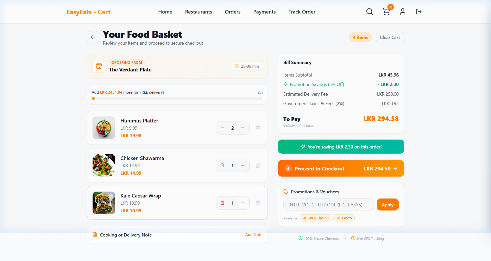
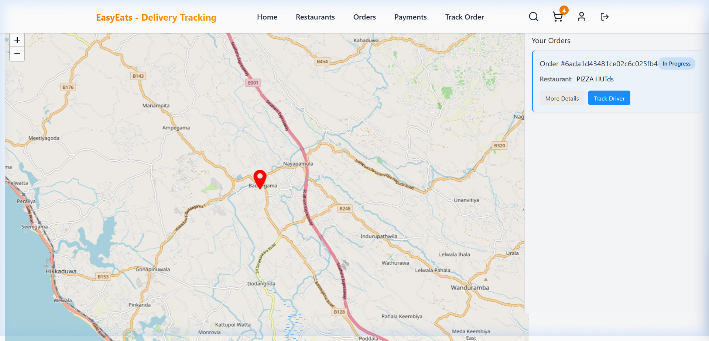
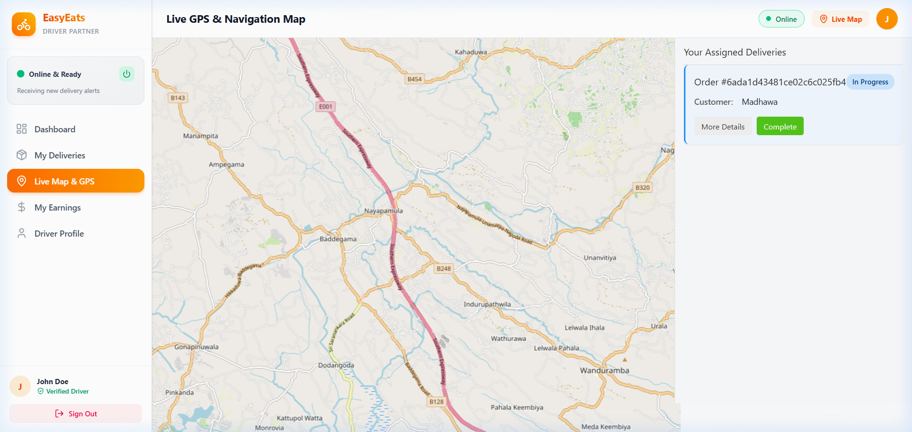
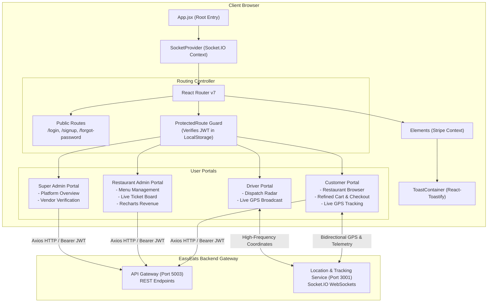

# 🍔 EasyEats Frontend — Next-Gen Food Delivery Web Experience

<p align="center">
  
</p>

<p align="center">
  <a href="https://react.dev/"></a>
  <a href="https://vitejs.dev/"></a>
  <a href="https://tailwindcss.com/"></a>
  <a href="https://socket.io/"></a>
  <a href="https://stripe.com/"></a>
  <a href="https://leafletjs.com/"></a>
</p>

---

## 📌 Table of Contents
- [📖 Overview](#-overview)
- [🔑 Verified Demo Credentials](#-verified-demo-credentials)
- [🎬 Live Walkthrough & Screen Recording](#-live-walkthrough--screen-recording)
- [📸 Real Application Screenshots & Gallery](#-real-application-screenshots--gallery)
- [🛒 Newly Refined Cart UI & Features](#-newly-refined-cart-ui--features)
- [🌟 Persona Features Deep Dive](#-persona-features-deep-dive)
- [📐 Application Architecture & Data Flow](#-application-architecture--data-flow)
- [📂 Project Directory Structure](#-project-directory-structure)
- [🛠️ Tech Stack & Key Libraries](#️-tech-stack--key-libraries)
- [🚀 Getting Started & Local Setup](#-getting-started--local-setup)
- [⚡ Real-Time WebSocket Events Reference](#-real-time-websocket-events-reference)

---

## 📖 Overview

**EasyEats Frontend** is an ultra-responsive, single-page food ordering and logistics application built with **React 18**, **Vite 6**, and **Tailwind CSS 4**. It connects customers, restaurant administrators, and delivery drivers with high-speed updates via WebSockets, interactive Leaflet maps, and PCI-compliant Stripe checkout.

---

## 🔑 Verified Demo Credentials

Use these verified accounts to test all platform features directly in your browser:

| Account Type | Email | Password | Access / Capabilities |
| :--- | :--- | :--- | :--- |
| 🧑‍🍳 **Customer** | `madhawaawishka@gmail.com` | `Madhawa123` | Browses restaurants, adds dishes to cart, applies promo codes, places orders, and tracks drivers on live maps |
| 🛵 **Delivery Person** | `john@gmail.com` | `Madhawa123` | Accesses driver dispatch radar, claims delivery assignments, and streams GPS coordinates |

---

## 🎬 Live Walkthrough & Screen Recording

Full real-data walkthrough featuring authenticated customer login, restaurant catalog browsing, menu inspection, cart interactions, and live map telemetry:

<p align="center">
  
</p>
<p align="center"><em>Live screen recording capturing authentic fetched data from the MongoDB Atlas backend, cart mutations, and live Leaflet GPS updates.</em></p>

---

## 📸 Real Application Screenshots & Gallery

<div align="center">
  <table>
    <tr>
      <td width="50%" align="center">
        <strong>🛒 Newly Refined Shopping Cart UI</strong><br/>
        <em>Free delivery threshold, promo discounts & order notes</em><br/><br/>
        
      </td>
      <td width="50%" align="center">
        <strong>🍽️ Real Restaurant Catalog (Customer)</strong><br/>
        <em>Live restaurants, distance, ratings & operational hours</em><br/><br/>
        
      </td>
    </tr>
    <tr>
      <td width="50%" align="center">
        <strong>📋 Menu Details & Dish Customization</strong><br/>
        <em>Categorized dish catalog, prices & ingredients</em><br/><br/>
        
      </td>
      <td width="50%" align="center">
        <strong>🗺️ Live GPS Delivery Tracking Map</strong><br/>
        <em>Real-time Leaflet map tracking driver en route</em><br/><br/>
        
      </td>
    </tr>
    <tr>
      <td width="50%" align="center">
        <strong>🛵 Driver Radar & Dispatch Control</strong><br/>
        <em>Delivery person view to claim orders & stream coordinates</em><br/><br/>
        
      </td>
      <td width="50%" align="center">
        <strong>📊 Restaurant & Dispatch Analytics</strong><br/>
        <em>Sales revenue charts, active tickets & fleet stats</em><br/><br/>
        
      </td>
    </tr>
  </table>
</div>

---

## 🛒 Newly Refined Cart UI & Features

The Shopping Cart (`src/pages/Cart.jsx`) has been completely upgraded with modern e-commerce interactions:
- 🚚 **Dynamic Free Delivery Progress Bar**: Progress meter toward the `2500 LKR` threshold with instant delivery fee deduction.
- 🎟️ **Promo Code Engine**: Built-in support for discount codes:
  - `WELCOME10`: 10% welcome discount.
  - `EASY5`: 5% member discount.
  - `FREEDEL`: 100% free delivery voucher.
- 📝 **Kitchen Order Notes**: Dedicated modal for cooking instructions and allergy notices.
- 🔄 **Cross-Component Cart Synchronization**: Syncs across pages using custom `cartUpdated` window events and `localStorage`.
- 🛡️ **Safety & Reliability Guarantees**: Delivery guarantee badges, tamper-evident packaging notices, and contact-free options.

---

## 🌟 Persona Features Deep Dive

### 🛍️ 1. Customer Journey
- **Proximity Discovery**: Automatically finds restaurants near the customer's coordinates using MongoDB `2dsphere` indexes.
- **Dietary & Cuisine Filtering**: Quick filter pills (Burgers, Pizza, Asian, Italian, Desserts, Vegan).
- **Stripe Elements Checkout**: Secure credit card payments using `@stripe/react-stripe-js` with automated order receipt creation.
- **Real-Time GPS Tracking**: Interactive map displaying driver coordinates, road paths, and dynamic ETA calculations.

### 🏪 2. Restaurant Admin Portal (`/admin/*`)
- **Revenue Analytics**: Visual financial performance metrics powered by **Recharts**.
- **Menu Items CRUD**: Create dishes, manage dietary tags, upload dish photos to Cloudinary, and toggle stock availability in real time.
- **Live Ticket Board**: Move orders across states: `Pending` ➔ `Processing` ➔ `Shipped` ➔ `Delivered`.

### 🛵 3. Delivery Driver Portal (`/driver/map`)
- **Order Dispatch Radar**: Instant audio/visual alert upon incoming Kafka `order_placed` notifications.
- **Live GPS Telemetry**: Broadcasts real-time geolocation coordinates directly to the customer's Leaflet map via Socket.IO.

### 👑 4. Super Admin Platform Portal (`/superadmin/*`)
- **Platform Analytics**: Global active users, total GMV, and order volume.
- **Vendor Governance**: Onboard, verify, or suspend restaurant vendors.
- **Financial Audit Ledger**: Comprehensive ledger of Stripe transactions and refunds.

---

## 📐 Application Architecture & Data Flow



---

## 📂 Project Directory Structure

```text
EasyEats-frontend/
├── docs/assets/                       # Screen recordings and real application screenshots
│   ├── demo_walkthrough.webp          # Full platform animated screen recording
│   ├── screenshot_cart.png            # Newly refined Cart UI screenshot
│   ├── screenshot_customer_home.png   # Real fetched restaurant catalog
│   ├── screenshot_restaurant_menu.png # Restaurant menu & dish list
│   ├── screenshot_customer_tracking.png # Real customer live Leaflet map
│   └── screenshot_driver_map.png      # Delivery driver radar & map
├── public/                            # Static public web assets
├── src/
│   ├── assets/                        # Local component styling assets
│   ├── components/                    # Reusable modular UI components
│   │   ├── banuka/                    # Geolocation & Leaflet map components
│   │   │   ├── hooks/                 # Custom driver tracking socket hooks
│   │   │   ├── Maps.jsx               # Interactive Leaflet live map widget
│   │   │   └── SocketContext.jsx      # Global Socket.io provider
│   │   ├── FoodCard.jsx               # Dish display card with add-to-cart
│   │   ├── FoodieCard.jsx             # Restaurant card with rating & distance
│   │   ├── Navbar.jsx                 # Dynamic responsive top navigation
│   │   ├── ProtectedRoute.jsx         # Client-side JWT auth guard
│   │   └── UserLayout.jsx             # Common dashboard shell layout
│   ├── lib/                           # Utility libraries and API callers
│   │   ├── api/                       # Axios API wrappers (resturants.js, users.js)
│   │   ├── auth.js                    # JWT extraction & storage helpers
│   │   └── utils.js                   # Class merging & formatters
│   ├── pages/                         # Application Views
│   │   ├── Admin/                     # Restaurant Admin portal
│   │   │   ├── AdminDashboard.jsx     # Recharts revenue & order metrics
│   │   │   ├── AdminMenu.jsx          # Menu items CRUD & category builder
│   │   │   ├── AdminOrders.jsx        # Live order progression Kanban board
│   │   │   ├── AdminEarnings.jsx      # Revenue analytics & payout history
│   │   │   └── AdminSettings.jsx      # Restaurant operational settings
│   │   ├── SuperAdmin/                # Super Admin platform oversight
│   │   ├── banuka/                    # Delivery tracking pages
│   │   │   └── DeliveryTrackingPage.jsx # Dual-mode driver/customer tracking
│   │   ├── Cart.jsx                   # Newly refined Shopping Cart view
│   │   ├── CreateResturant.jsx        # Restaurant onboarding wizard
│   │   ├── Home.jsx                   # Customer landing view
│   │   ├── Login.jsx                  # Multi-role authentication page
│   │   ├── Order.jsx                  # Checkout summary & address selection
│   │   ├── OrderConfirmed.jsx         # Post-order celebration & receipt
│   │   ├── Payment.jsx                # Payment gateway selector
│   │   ├── Profile.jsx                # User account & address book editor
│   │   ├── Restaurant.jsx             # Restaurant directory with category filters
│   │   ├── ResturantDetails.jsx       # Full restaurant menu & dish customization
│   │   ├── SearchDishes.jsx           # Global dish keyword and tag search
│   │   ├── SignUp.jsx                 # Multi-role registration screen
│   │   └── Stripepayment.jsx          # Stripe Elements card checkout flow
│   ├── App.jsx                        # Routing hub, Stripe & Socket config
│   ├── index.css                      # Tailwind CSS root styles
│   └── main.jsx                       # React DOM mount point
├── .env.example                       # Sample environment configuration
├── package.json                       # Dependencies & scripts
└── vite.config.js                     # Vite build configuration
```

---

## 🛠️ Tech Stack & Key Libraries

| Technology | Version | Purpose |
| :--- | :--- | :--- |
| **React** | `^18.2.0` | Declarative component UI library |
| **Vite** | `^6.3.1` | Build tool and dev server with instant HMR |
| **Tailwind CSS** | `^4.1.4` | Modern utility-first CSS styling engine |
| **React Router DOM** | `^7.5.1` | Declarative routing and route protection |
| **Socket.io Client** | `^4.8.1` | WebSocket client for live GPS telemetry and alerts |
| **Leaflet & React-Leaflet**| `^1.9.4 / ^4.2.1` | Interactive map rendering for delivery tracking |
| **Stripe React SDK** | `^2.4.0` | PCI-compliant Stripe Elements payment processing |
| **Recharts** | `^2.15.3` | Financial and order metrics visualization |
| **Lucide React** | `^0.503.0` | Modern, clean vector iconography |
| **Axios** | `^1.9.0` | HTTP client for REST API communication |
| **SweetAlert2 & Toastify**| `^11.20.0 / ^11.0.5` | Polished user confirmation dialogs and toasts |

---

## 🚀 Getting Started & Local Setup

### 1. Clone & Install Dependencies
```bash
git clone https://github.com/EasyEats-DS/EasyEats-frontend.git
cd EasyEats-frontend
npm install
```

### 2. Configure Environment Variables
Create a `.env` file in the root:
```env
VITE_BASE_URL=http://localhost:5003
VITE_STRIPE_PUBLISHABLE_KEY=pk_test_51RGkbGP1kuLOW6vWZKk31RXfliqSdJvsCn7WU9kXYsCPwulxzli7FN1OnltQGeMIODZAPy9RTd3qwaMlMkTXAvp200Wf8d90Fr
```

### 3. Start Development Server
```bash
npm run dev
```
Open **`http://localhost:5173`** and use the [Demo Credentials](#-verified-demo-credentials) to test the app!

---

## ⚡ Real-Time WebSocket Events Reference

| Event Name | Direction | Payload Example | Description |
| :--- | :--- | :--- | :--- |
| `identify` | Client ➔ Server | `{ userId: "6ad9d...", role: "driver" }` | Registers user session on the socket server |
| `accept_order` | Driver ➔ Server | `{ orderId: "ord_99", driverId: "6ada0..." }` | Driver claims an incoming delivery order |
| `live_location` | Driver ➔ Server | `{ driverId: "6ada0...", latitude: 6.927, longitude: 79.861 }` | Periodic GPS telemetry update |
| `live_location` | Server ➔ Customer | `{ driverId: "6ada0...", latitude: 6.927, longitude: 79.861 }` | Streams driver position to Customer Map |
| `status_update` | Driver ➔ Server | `{ orderId: "ord_99", status: "Out for Delivery" }` | Advances order delivery milestone |
| `new_order` | Server ➔ Driver | `{ orderId: "ord_99", restaurantId: "..." }` | Dispatches order ticket to available nearby drivers |

---

## 📄 License & Attribution

This project is part of the **EasyEats Distributed Platform**.  
Licensed under the **MIT License**.
